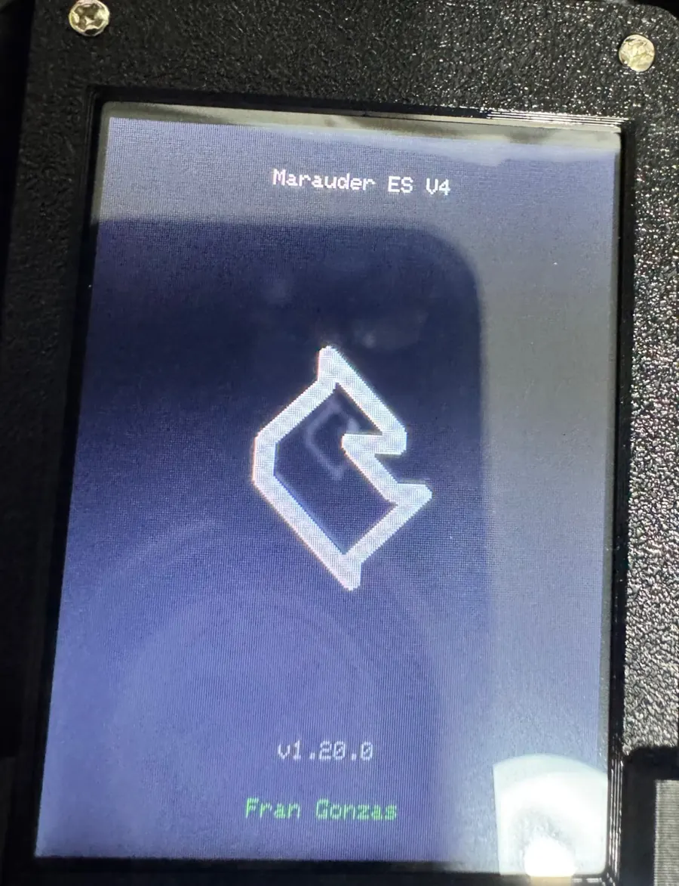
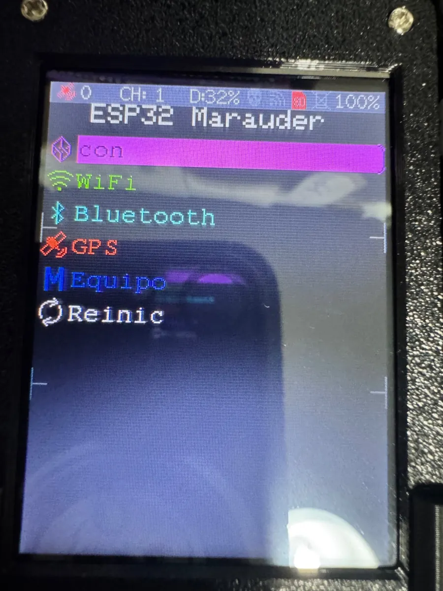
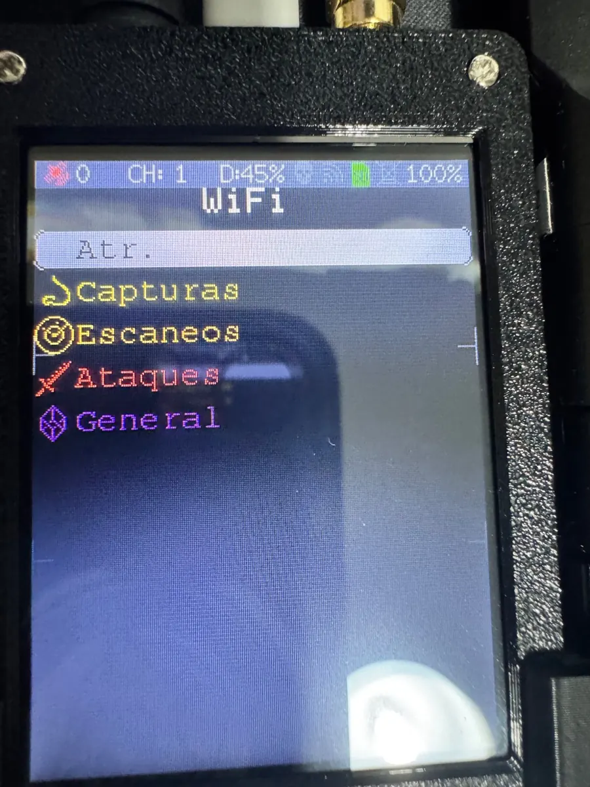
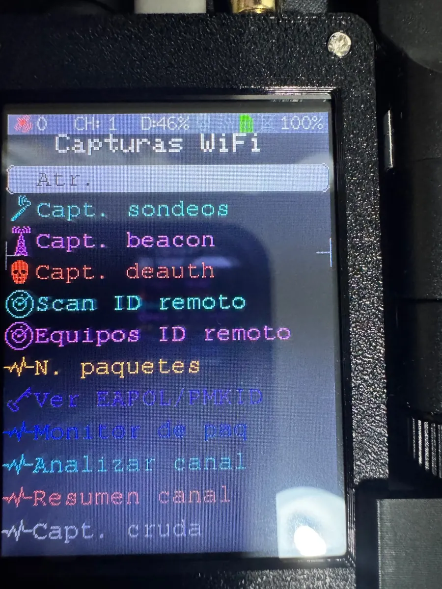
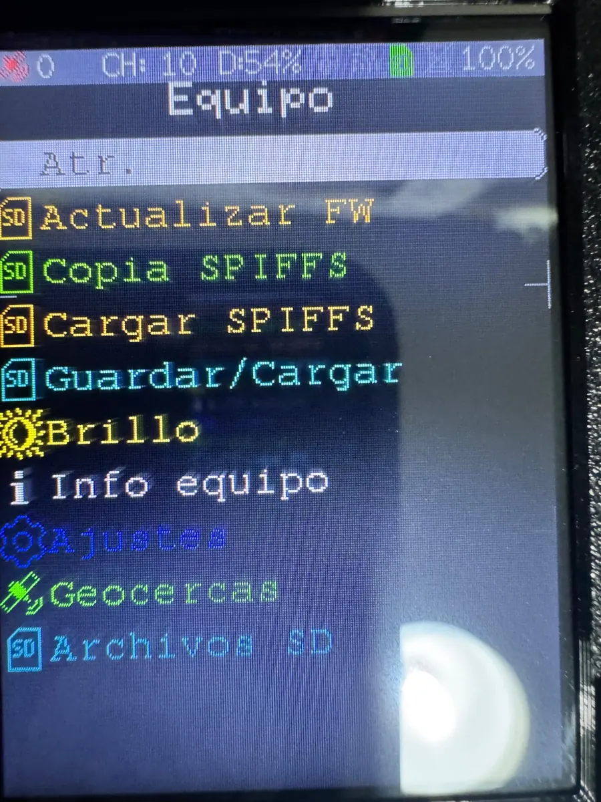
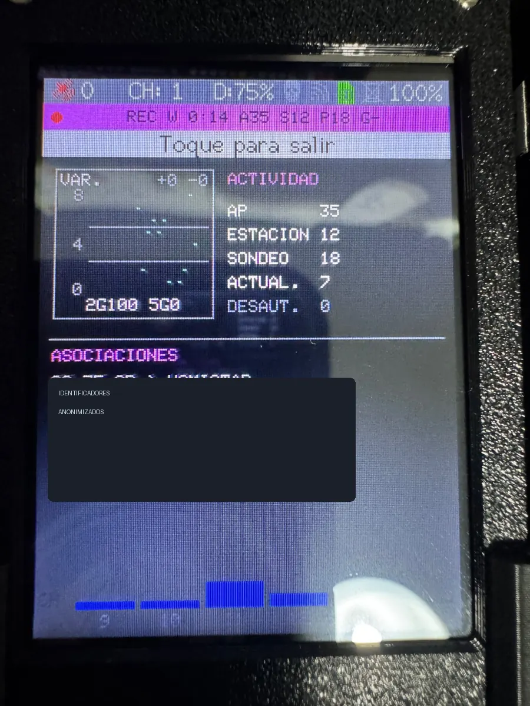

# Galería del dispositivo — ESP32 Marauder v1.20.0 ES V4

Fotografías reales de un dispositivo **MaKing Lab** ejecutando la adaptación comunitaria al español, **ESP32 Marauder v1.20.0 ES V4 — Fran Gonzas**, correspondiente al perfil de placa **Marauder v6.1**.

Las fotografías se han redimensionado y optimizado en **WebP** para minimizar el tamaño del repositorio, sin modificar los textos representativos del firmware. También se han eliminado los metadatos de cámara. En la captura de actividad se han ocultado identificadores de dispositivos encontrados durante la exploración.

## Arranque personalizado

La pantalla de inicio conserva el logotipo y la versión del proyecto original y muestra la identificación de esta adaptación española.

## Menú principal

## Menú WiFi

## Capturas WiFi

## Menú Equipo

## Monitor de paquetes

Se han ocultado datos identificativos de dispositivos de terceros. Las fotografías son una demostración visual de la interfaz; **no** certifican exhaustivamente el comportamiento de todas las funciones radio.

---

### Créditos y procedencia

- **Proyecto original:** [Just Call Me Koko — ESP32 Marauder](https://github.com/justcallmekoko/ESP32Marauder).
- **Firmware base:** [ESP32 Marauder v1.20.0](https://github.com/justcallmekoko/ESP32Marauder/releases/tag/v1.20.0).
- **Adaptación y documentación fotográfica:** Fran Gonzas.
- **Relación con el autor original:** proyecto comunitario no oficial, sin afiliación ni aval.
- Las fotografías se han facilitado para documentar esta adaptación. Su publicación en este repositorio no implica que la licencia MIT del software conceda automáticamente derechos adicionales sobre las imágenes.

[Volver al README principal](../README.md).
